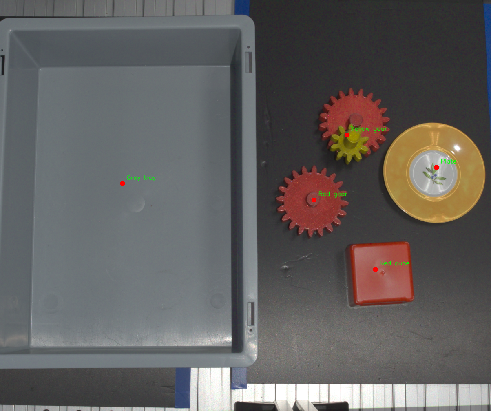

<!-- _class: title -->
<!-- _paginate: false -->
<!-- _footer: '' -->

# Aperceptia

## Qwen2.5-VL *sees*, Apertus *decides*

From a photo of a robot workcell and an English instruction: a safe pick-and-place plan, a clarifying question, or a refusal.

**Apertus-v1.5-8B makes every language decision.**

Team NeuralForce · Gian-Luca Tehrani
Hack Apertus · Track 2A · See It, Say It, Pick It (ZHAW)

---

# Pipeline: which model does what

Input: `rgb.png` + an English instruction

1. **Qwen2.5-VL 7B** Only *sees*: lists the objects with one pixel each and their relations. Never decides.
2. **Apertus-v1.5-8B** One call, JSON schema. Decides *execute / ask / refuse* and writes the plan, the question or the reason.
3. **Safety net** Keyword rules *after* Apertus. Can only make the answer more cautious.
4. **Planner** Robot limits (one object, 85 mm gripper), target pixel, official JSON.

3 Docker containers: `ollama` · `apertus` (vLLM, 4-bit) · `pipeline` · one command: `make run`

---

# Results on the development set

Official scorer · 10 scenes · 50 instructions · total score / 65

1. Starting point: Qwen3, no safety rules **29.9**
2. Apertus, first prompts: free-form, several calls **24.5**
3. Apertus, one call, JSON schema, safety net **41.1**
4. Final: Apertus, one call, JSON schema, order repair, examples **47.9**

- **26.2** grounding / 35
- **21.6** safety / 30
- **24.5 → 47.9** Apertus score, first prompts to final
- **40 / 40** held-out answers in the official format

---

# Failure cases and difficulties with Apertus

- **Apertus**
  - First prompts, without JSON schema: 24.5 / 65, worse than the Qwen3 starting point
  - Misses obvious refusals: plate, throw, pull from under, contradiction, hand (5 caught by the safety net)
  - Three identical red cubes, "pick the red cube": picks one instead of asking which one
  - "the red gear under the yellow gear in the tray": mixes up which object is on top
- **Setup**
  - Upstream vLLM does not support Apertus 1.5: swiss-ai image, 4-bit + fp8 KV cache on 12 GB, the two models run one after the other
- **Perception** (image: Qwen2.5-VL output on a dev scene)
  - The red gear *under* the yellow gear is not detected · black tray never detected · grey parts mislabelled

---

# Lessons and next steps

- **Lessons**
  - *Constrained decoding* is the biggest lever: object ids as an enum stop invented objects and broken formats
  - One short, focused prompt per instruction beats a chain of prompts
  - Let Apertus decide; rules only as a safety net *after* it
  - Perception is now the bottleneck: a wrong object list cannot be fixed later
- **Next steps**
  - A detector or segmenter for exact masks, the black tray and stacked objects
  - Make Apertus count identical objects before deciding, to ask when needed
  - Fine-tune Apertus on refusals and clarifications, so the safety net is no longer needed
